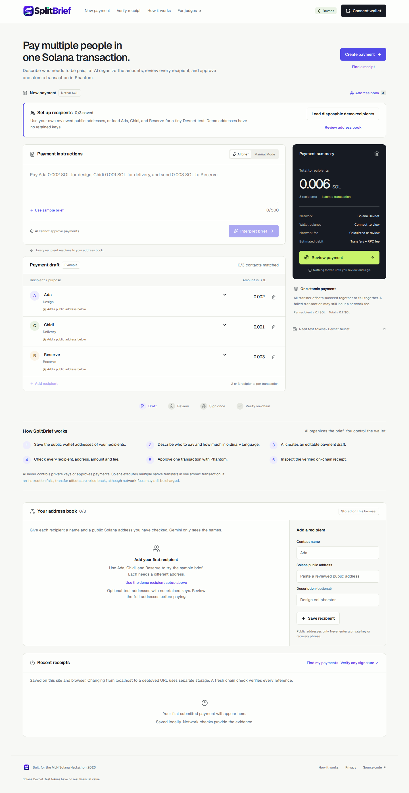

<p align="center">
  
</p>

# SplitBrief

**One brief. Multiple recipients. One Solana transaction.**

SplitBrief turns everyday payment instructions into an editable plan. Users review every recipient and amount, approve once in Phantom, and receive an independently verifiable Solana receipt. Built for small businesses, freelancers and teams who need to pay several people without preparing separate transfers.

**[Live app](https://splitbrief-zeta.vercel.app)** · **[Watch the narrated demo](https://splitbrief-zeta.vercel.app/demo)** · **[YouTube](https://youtu.be/WdmFjonqd5E)** · **[Verified receipt](https://splitbrief-zeta.vercel.app/verify?signature=5mfAUjRWXLVDRjV74L9nL8Uk5heLW9NMiJyKpPoHVQmKRjen7DAcEh66DDTJGYDFj72zqRr3zfvzEzkPD5wdxfu)** · **[For judges](https://splitbrief-zeta.vercel.app/judges)**



## For judges: inspect the real result first

| Start here | What it proves |
| --- | --- |
| [108-second narrated demo](https://splitbrief-zeta.vercel.app/demo) | The product workflow, with real application footage and an accessible transcript. |
| [Finalized Devnet receipt](https://splitbrief-zeta.vercel.app/verify?signature=5mfAUjRWXLVDRjV74L9nL8Uk5heLW9NMiJyKpPoHVQmKRjen7DAcEh66DDTJGYDFj72zqRr3zfvzEzkPD5wdxfu) | Three native SOL transfers in one confirmed transaction; independently inspected amounts, recipients and fee. |
| [Source evidence](public/evidence/devnet-batch.json) | The recorded network evidence underlying the receipt. |
| [Judge walkthrough](docs/JUDGE_WALKTHROUGH.md) | A safe path through the application, including what is demonstrated versus what is not. |

You can verify the recorded transfer without connecting a wallet. To try a new payment, use **Phantom on Solana Devnet** and disposable test SOL only.

## The problem

A small-business owner needs to pay a designer, delivery partner and project reserve. The instructions arrive in one message, but repeatedly entering wallet addresses and amounts takes time and creates room for mistakes.

**SplitBrief brings the entire payment into one reviewable workflow.** AI organizes the instructions; the user controls the destinations, signs the payment, and can verify what happened.

## Why we built it

The tedious part of paying several people is not deciding *that* they should be paid. It is translating a brief into separate recipient entries, checking each wallet address and amount, and later reconstructing whether every transfer went through. We built SplitBrief to make those checks **one reviewable decision**, while keeping the private key and final authorization with the payer.

It is intended as a small, testable payment workflow—not a payroll system, an autonomous payment agent, or a service that can choose someone's destination on the user's behalf.

## How it works

1. **Add recipients** — Save names and checked public Solana addresses in a browser-local address book.
2. **Describe the payment** — Write a brief such as “Pay Ada 0.002 SOL, Chidi 0.001 SOL, and 0.003 SOL to Reserve.”
3. **Review the plan** — Gemini extracts amounts and purposes into an editable draft. Manual Mode is available. AI never chooses addresses.
4. **Approve once** — Inspect recipients, amounts and fees, then sign one transaction through Phantom.
5. **Verify on-chain** — Inspect the actual transfers, fee, finalization status and public Solana Explorer link.

**AI organizes. You approve. Solana verifies.** All native transfers share one atomic transaction: they succeed together or roll back together, although failed transactions may still incur a network fee.

## What makes the workflow different

- **The model drafts; it does not pay.** Gemini extracts instructions into an editable plan, while recipient addresses come only from a user-reviewed address book. Manual Mode avoids depending on AI availability.
- **One approval covers a batch.** Native SOL transfers are placed in one atomic transaction rather than presented as independently completed payments; network fees can still apply when a transaction fails.
- **The receipt is checked after signing.** The application reads the actual transaction through Solana RPC and shows finalization, transfer instructions, amounts, fees and an Explorer link.
- **Claims have a boundary.** The published payment is genuine Devnet evidence, not a mainnet deployment or a measured reduction in processing time. The original frozen payment-plan snapshot was not independently recovered.

## Features

| | |
| --- | --- |
| **AI payment briefs** | Genuine Gemini interpretation, editable drafts and Manual Mode |
| **Recipient address book** | Saved public addresses with reviewable name-to-wallet mapping |
| **Atomic payments** | Multiple native SOL transfers in one Phantom-approved transaction |
| **Payment safety** | Exact lamport arithmetic, fee review, spending limits and strict transaction validation |
| **Verified receipts** | Fresh RPC verification, signature, transfers, Explorer links and local history |

## Working Devnet proof

A real transaction approved through the deployed app **finalized three native SOL transfers totaling 0.006 SOL**, with a **0.000005 SOL** network fee.

| Recipient | Amount |
| --- | ---: |
| Ada | 0.002 SOL |
| Chidi | 0.001 SOL |
| Reserve | 0.003 SOL |
| **Total** | **0.006 SOL** |

**[Inspect in SplitBrief](https://splitbrief-zeta.vercel.app/verify?signature=5mfAUjRWXLVDRjV74L9nL8Uk5heLW9NMiJyKpPoHVQmKRjen7DAcEh66DDTJGYDFj72zqRr3zfvzEzkPD5wdxfu)** · **[Open Solana Explorer](https://explorer.solana.com/tx/5mfAUjRWXLVDRjV74L9nL8Uk5heLW9NMiJyKpPoHVQmKRjen7DAcEh66DDTJGYDFj72zqRr3zfvzEzkPD5wdxfu?cluster=devnet)** · **[RPC evidence](public/evidence/devnet-batch.json)**

Independent RPC inspection confirms the payer, recipients, amounts, order and fee controls against the published demo configuration. The genuine [app screenshot](public/evidence/successful-devnet-receipt.webp) displays “Finalized & matched”; the original frozen review snapshot was not separately recovered.

Additional verified evidence: [Gemini structured response](public/evidence/gemini.json) and [local atomic execution/rollback](public/evidence/local-chain.json). Latest documented checks passed **192 unit/integration tests, 21 browser tests and 8 local-chain assertions**. [Testing details](docs/TESTING.md).

## Try it

Start with the [live app](https://splitbrief-zeta.vercel.app), or [watch the 108-second narrated demo](https://splitbrief-zeta.vercel.app/demo), which includes an accessible transcript. The [judge walkthrough](docs/JUDGE_WALKTHROUGH.md) explains the product and evidence step by step.

To send a test payment, connect Phantom in **Solana Devnet** mode and use test SOL. You can load disposable example recipients or enter public addresses you control. SplitBrief does not collect private keys.

This is a **Devnet hackathon MVP**, not a mainnet payroll or custody service. Test SOL has no monetary value.

## Tech stack and local setup

Built with **Next.js, React, TypeScript, Tailwind CSS, Solana Kit, Wallet Standard, Phantom, Google Gemini, Zod and Vercel**. There is no custom smart contract, custodial wallet backend or application database.

Requires Node.js 24:

```bash
git clone https://github.com/sopskistar/SplitBrief.git
cd SplitBrief
nvm use 24
npm ci
test -e .env.local || cp .env.example .env.local
npm run dev
```

Add `GEMINI_API_KEY` to the ignored `.env.local` file for AI interpretation; Manual Mode works without it. Never commit wallet secrets or API keys.

Tests: `npm run lint`, `npm run typecheck`, `npm run test`, `npm run test:e2e` and `npm run build`.

[Architecture](docs/ARCHITECTURE.md) · [Testing](docs/TESTING.md) · [Deployment](docs/DEPLOYMENT.md)

## Hackathon

**Submitted to the MLH Solana Hackathon, November 6–8, 2026.** The project includes a [108-second narrated demo](https://splitbrief-zeta.vercel.app/demo), an independently verified public Devnet batch and open test evidence. Built with **OpenAI Codex** assistance using the public Solana Foundation Kit Next.js starter and open-source dependencies.

[Judges and evidence](https://splitbrief-zeta.vercel.app/judges) · [Submission details](docs/SUBMISSION.md) · [MIT License](LICENSE)
