# Architecture and trust boundaries

```mermaid
flowchart LR
  Brief[Untrusted payment brief + contact names] --> API[Next.js server route]
  API --> Gemini[Google Gemini structured JSON]
  Gemini --> Schema[Zod + literal amount/label checks]
  Schema --> Draft[Editable browser draft]
  Book[Local reviewed public address book] --> Draft
  Draft --> Validation[Bigint amounts, caps, duplicate/self checks]
  Validation --> Review[Frozen plan + RPC balance/fee]
  Review --> Wallet[Wallet Standard Devnet signTransaction]
  Wallet --> Bytes[Compare signed bytes + verify signature]
  Bytes --> Single[One transaction / one broadcast attempt]
  Single --> RPC[Solana Devnet RPC]
  RPC --> Decode[Full instruction decoder]
  Review --> Match[Compare payer + destinations + amounts + order/count]
  Decode --> Match
  Match --> Receipt[Confirmed/finalized and matched receipt]
```

## Browser

`app/components/workspace.tsx` manages draft, preparation, final review, signing, submission, and receipt states. `lib/payments.ts` validates inputs independently of Gemini. Decimal SOL conversion uses bigint and rejects precision beyond nine places rather than rounding. Contact names resolve exactly to validated stored addresses. Contacts cannot change while review/signing is frozen.

The supported Solana wallet plugin discovers Wallet Standard wallets for `solana:devnet`; `@solana/react` provides its client. The app requires version 0 and inspectable `signTransaction` capability. Wallet Standard advertises supported chains rather than exposing every extension's currently selected UI network: the app requests Devnet explicitly, verifies RPC genesis, and tells the owner to select Devnet in Phantom. Human approval remains a real wallet interaction.

`lib/solana.ts` builds one Kit message with 2–3 `@solana-program/system` native transfer instructions. It compiles that message to estimate fees, rechecks balance and blockheight before signing, checks the returned bytes and Ed25519 signature, and broadcasts exactly once. No backend key exists. New plans explicitly include a 10,000 CU limit and zero unit price before the native transfers; this prevents documented Phantom automatic fee additions without relaxing byte equality. A separately copied signer input protects the frozen baseline. The RPC quote is rechecked before signing, and the approved fee travels in the plan snapshot. See [the signing investigation](WALLET_SIGNING.md).

## Server and model

`POST /api/interpret` accepts at most 4,096 body bytes, a 500-character instruction, and three distinct names. It invokes Google GenAI 3.0.0's documented Interactions API with a JSON `response_format`, a low thinking level, `store:false`, no automatic continuation, a 1,024-token cap, a 270-second application deadline (285 seconds in the browser and 300 seconds on Vercel), and no SDK retries. Provider errors never create a valid draft. The server maps errors to nonsecret status/code messages.

Model output has only recipient label, decimal SOL string, purpose, warnings, and clarification status. It cannot return an address or transaction. Output labels must belong to the supplied list and appear as complete labels in the brief; amounts must be explicitly present numeric literals. These checks constrain output but do not replace human review of language interpretation or recipient identity.

Rate limiting stores six AI request attempts per minute per best-effort client identifier in a bounded in-memory map. This is per server instance, not a durable or global spend control. Use Google project quotas and billing safeguards. No database was introduced.

## Chain verification and uncertainty

Every product RPC path checks the full Devnet genesis hash `EtWTRABZaYq6iMfeYKouRu166VU2xqa1wcaWoxPkrZBG`. `fetchReceipt` retrieves both the actual `jsonParsed` transaction at confirmed commitment and current signature status. The decoder inspects execution metadata, payer/signer, all outer instructions, and inner instructions. Unexpected programs/extra transfers produce issues. An expected plan matches only on successful execution with identical payer, source, destinations, amounts, instruction count/order, and no unexpected instructions. Plans with the fixed fee policy require exactly the two reviewed fee controls and an actual fee no higher than the approved estimate; historical transfer-only plans keep their original expectations.

Without an expected plan, `/verify` says **On-chain transaction decoded**. It cannot claim to match an unknown payment brief. RPC remains a trust boundary: this is an inspection of RPC-reported chain data, not a cryptographic light client. Missing, pruned, reset, rate-limited, or unavailable history stays unverified.

Submission callbacks retain the original signature and review snapshot even if an HTTP response is lost. There is no automatic payment retry. Pending recovery checks that both transaction and status are absent, the original last-valid blockheight has passed, and its blockhash is invalid. Only then can the user explicitly start a new review. Missing history still cannot prove a prior payment never landed.

## Storage and tests

Only browser-local contacts, submitted references, pending expiry metadata, and review snapshots persist. They are revalidated and never treated as settlement proof or automatically rebuilt into a transaction. The separate test harness generates signers in memory, executes against offline Surfpool, and discards keys on exit. It does not share a signer with the deployed product or the owner's Phantom.

Verified-only bookmarks can store a signature without a plan; they never invent a prior review. History validates each entry separately so one corrupt entry does not erase valid references. History is origin-specific: localhost and the deployed site have separate localStorage. Connected-wallet recovery reads recent public signatures, filters the actual batch profile, and stores references without claiming original intent. Every displayed status is refreshed from RPC.
